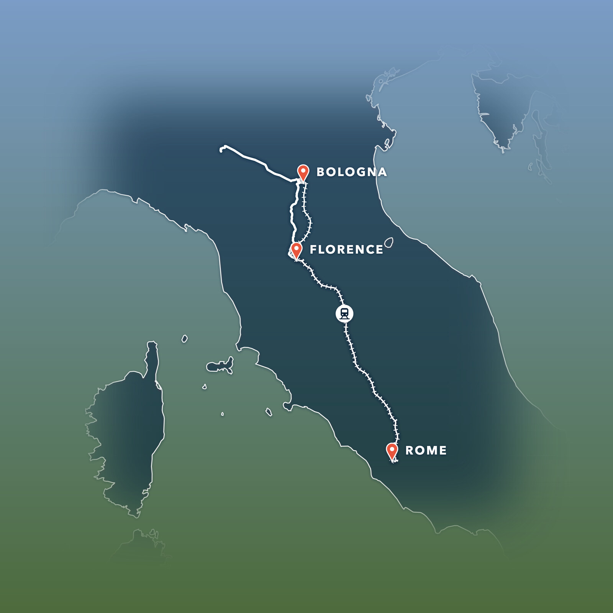

# tripmap

Turns a trip in your Photos library into a transparent route-map PNG to lay over an
album photo. The look is fixed: white roads, red pins for overnight stops, gold stars
for quick stops, a railway track with cross-ties and a train badge for train legs,
dashed boat legs with a ship badge, dashed flight arcs with a plane badge, and navy
land with a white coastline.



- [Install](#install)
- [Quick start](#quick-start)
- [Commands](#commands)
- [Web app](#web-app): a local browser editor for drafts, with render and photo preview
- [Trip files](docs/trip-format.md): stops, legs, modes, basemaps
- [How `draft` decides](docs/how-draft-works.md): overnights, stars, boats, trains, flights
- [HTTP API](docs/api.md): the `tripmap-api` endpoints behind the web app
- [Privacy and network use](#privacy-and-network-use)
- [Troubleshooting](#troubleshooting)
- [Development](#development)

## Requirements

- **macOS**, with a Photos library that has GPS-tagged photos. The library is read from
  `~/Pictures/Photos Library.photoslibrary` by default (`--library` overrides it).
- **[uv](https://docs.astral.sh/uv/)** to install and run tripmap. Python 3.11 or newer
  is fetched by uv if you don't have one.
- **Google Chrome or Chromium**, used headless to rasterize the SVG into the PNG. It is found
  at `/Applications/Google Chrome.app`, or on your PATH, or set with `TRIPMAP_CHROME`.
- **ImageMagick** (`magick` on your PATH), only for `render --photo`.
- Internet access on the first run, for the basemap data and route lookups (see
  [Privacy and network use](#privacy-and-network-use)).

## Install

From a checkout of this repository:

```sh
git clone git@github.com:stephengolub/tripmap.git ~/code/tripmap
uv tool install --editable ~/code/tripmap
tripmap --help
```

`--editable` means edits under `src/tripmap/` take effect immediately, with no reinstall. To
upgrade the dependencies later, run `uv tool upgrade tripmap`.

## Quick start

```sh
tripmap trips --since 2024-01-01                           # find trips and their dates
tripmap draft --from 2026-04-29 --to 2026-05-08 -o ireland.yaml
#   ...edit ireland.yaml: rename stops, hide a hop, fix a mode...
tripmap render ireland.yaml --photo album-page.jpg         # -> ireland.png and a preview
```

`draft` writes a YAML file describing the route. `render` reads it and writes:

- `<name>.png`: the overlay, transparent, at 4000 px on the long side.
- `<name>-with-day-trips.png`: only if some legs are marked `day_trip: true`. The plain
  version leaves those out.
- `<name>-preview.jpg`: only with `--photo`. The overlay composited on your photo, to check
  placement before you use the PNG.

Edit the YAML between the two steps. Most corrections are a rename, a `kind` change, or
moving a leg from `drive` to `train`. Re-running `render` is cheap, since routes are cached.

## Commands

### `tripmap trips`

Lists trips found in the Photos library: runs of photos taken away from home.

| Flag | Default | Meaning |
|---|---|---|
| `--since YYYY-MM-DD` | none | Only trips starting after this date. |
| `--away-km N` | `150` | Distance from home that counts as being away. |
| `--min-photos N` | `30` | Trips with fewer photos are not listed. |

### `tripmap draft`

Detects the route for a date range and writes an editable trip file.

| Flag | Default | Meaning |
|---|---|---|
| `--from YYYY-MM-DD` | required | First day, inclusive. |
| `--to YYYY-MM-DD` | required | Last day, inclusive. |
| `-o, --output PATH` | `trip.yaml` | Where to write the trip file. |
| `--title TEXT` | `Trip May 2 – May 8, 2024` | Title stored in the file. |

### `tripmap render`

Draws a trip file as transparent PNG overlays.

| Argument or flag | Default | Meaning |
|---|---|---|
| `TRIP` | required | Trip YAML file. |
| `--photo PATH` | none | Background photo. Sets the canvas shape to match it and writes a preview. |
| `--out DIR` | next to the YAML | Output folder. |
| `--size N` | `4000` | Long side of the PNG, in pixels. |

### Global

`--library PATH` points at a different Photos library.

## Web app

A browser editor over the same code: draft a trip from Photos, fix stops and legs on a
map, render the PNG, and preview it over a photo. It is a local app for this Mac, not a
hosted service.

```sh
uv sync --all-extras       # once: installs FastAPI and uvicorn (the "web" extra)
scripts/dev.sh             # API on 127.0.0.1:8000, app on http://localhost:5173
```

`scripts/dev.sh` runs both servers in the foreground and stops both on Ctrl-C. It runs
`npm install` at the repo root (npm workspaces) the first time. Open http://localhost:5173.

**Photos needs Full Disk Access.** macOS blocks reading the Photos library until the app
that started the server is allowed. Open **System Settings > Privacy & Security > Full Disk
Access**, turn it on for your terminal app (Terminal, iTerm, or whatever ran
`scripts/dev.sh`), then quit and reopen that app and start the script again. The web app
checks this on load and says so when it is blocked. Opening a YAML file works without it;
only drafting from Photos needs it.

In the app:

- **Draft** a date range, the same as `tripmap draft`. It takes tens of seconds.
- **Edit** stops and legs. The map shows OpenStreetMap tiles.
- **Render** draws the PNG at 1600 px, with a "Show day trips" toggle and a download link.
- **Photo preview** composites the PNG over a photo you pick. The photo is read in the
  browser and never uploaded.
- **Open YAML** and **Save YAML** load and save the same trip files the CLI uses.

**Nothing is saved on the server.** The API is stateless: the trip lives in the browser
tab and goes to the server in each request. Close the tab without saving YAML and the
edits are gone. The server binds to `127.0.0.1` only and never logs coordinates or photo
paths. The endpoints are in [docs/api.md](docs/api.md).

## Trip files

A trip file has a title, a basemap, a list of **stops** (pins, stars, or hidden points),
and a list of **legs** (the travel between stops, each with a mode). The full field
reference is in [docs/trip-format.md](docs/trip-format.md).

```yaml
title: "Italy 2024"
basemap: auto
stops:
  - {name: "Bologna", kind: major, at: [44.4938, 11.3426], label: auto}
  - {name: "Florence", kind: major, at: [43.7698, 11.2556], label: auto}
legs:
  - {date: 2024-05-03, mode: train, day_trip: false, via: ["Bologna", "Florence"]}
```

## Privacy and network use

Photos is read from a temporary copy of `Photos.sqlite` (with its `-wal` and `-shm`
files). The live library is never opened or modified.

Only these things leave your machine, and each is cached under `~/.cache/tripmap`:

| Service | Sent | Why |
|---|---|---|
| Nominatim (OpenStreetMap) | Town **names** only | To find town centres for overnight pins. |
| Overpass (OpenStreetMap) | Coordinates rounded to ~100 m | Landmark names for quick stops; railway stations near stops. |
| OSRM (router.project-osrm.org) | Route points rounded to ~100 m | Road shapes, and whether a hop is drivable. |
| BRouter (brouter.de) | Station and route-hint points rounded to ~100 m | Railway geometry for train legs. |
| raw.githubusercontent.com | Nothing | Natural Earth coastline data, downloaded once. |

Lookups are best-effort. If a service is down, the draft still completes, with those names
or shapes left out, and the log says so.

Place names come from data Photos already stores on your Mac.

## Troubleshooting

**`Rendering needs Google Chrome or Chromium`** tripmap couldn't find a browser. Install
Chrome, or point at an existing one: `export TRIPMAP_CHROME=/usr/bin/chromium`. The lookup
order is `$TRIPMAP_CHROME`, then `/Applications/Google Chrome.app`, then `google-chrome`,
`chromium` or `chromium-browser` on your PATH.

**`--photo` fails with `magick: command not found`.** Install ImageMagick (`brew install imagemagick`).

**A train leg is drawn as a smooth curve, not following the rails.** Its rail route was
not found, so tripmap drew a smooth curve through its points in track style and logged
`no rail line found`. Check that the stops are near stations, or change the leg's `mode`.

**A train leg you did not take, or a train you took came out as a drive.** Detection trusts
photo timestamps. Two devices with clocks an hour apart can fake a speed. Set the leg's
`mode` by hand. See [How `draft` decides](docs/how-draft-works.md#train-legs).

**Overnight names look wrong (a townland, or a neighbouring village).** Edit the stop's
`name` in `stops`, and in every leg whose `via` refers to it.

**Landmark or road lookups keep failing.** The public Overpass and OSRM servers are often
overloaded. Wait and re-run `draft`. Successful lookups are cached, so only the missing
ones are retried.

**Cache is stale or corrupt.** Delete `~/.cache/tripmap/` and re-run. It is rebuilt on demand.

## Development

tripmap is a Python package in `src/`, packaged with uv. Dependencies and the dev
environment are defined in `pyproject.toml`, with the exact resolved versions in `uv.lock`.

```sh
uv sync            # create .venv with the dependencies and pytest
uv run pytest      # run the test suite (no network, no Photos library needed)
uv run tripmap --help
```

Layout:

- `src/tripmap/__init__.py`: the whole CLI. `cmd_draft` detects the route, `build_svg` draws it,
  `cmd_render` writes the files.
- `tests/`: unit tests. Network calls are stubbed and the cache is redirected to a temp
  directory, so the suite is offline and leaves `~/.cache/tripmap` alone.
- `examples/`: real trip data and previews. See the note in `CLAUDE.md` about publishing.
- `src/tripmap_api/`: the FastAPI app behind the web app.
- `packages/web/`: the Vite + React + TypeScript front end. `npm test` (Vitest) and
  `npm run test:e2e` (Playwright; starts both servers itself).
- `scripts/dev.sh`: runs the web app locally.
- `docs/`: the trip-file reference, the detection rules, and the HTTP API.

Not covered by tests yet: the detection logic inside `cmd_draft` (it is nested, so it can't
be called on its own), the full SVG render, and the Photos database reader. The `examples/`
drafts and previews are the regression check for those.
